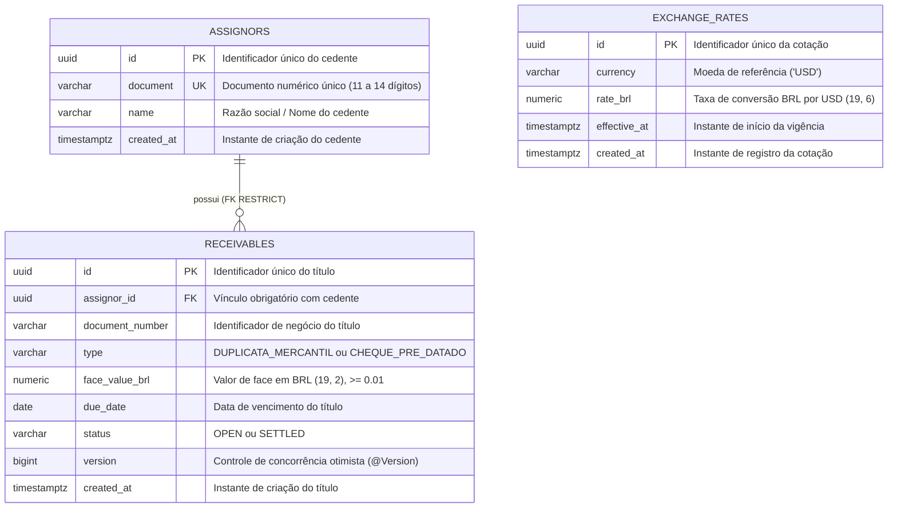

# SRM Credit Engine — Diagrama Entidade-Relacionamento (ER)

> **Versão do schema:** V2 (TASK-005)  
> **Banco de dados:** PostgreSQL 16+  
> **Evolução:** Flyway migrations versionadas (`V1`, `V2`)  
> **Hibernate DDL:** `validate` (sem geração automática)

## 1. Visão Geral

Este documento descreve o modelo físico de dados inicial do SRM Credit Engine, cobrindo os módulos de cedentes (`assignors`), títulos recebíveis (`receivables`) e cotações cambiais (`exchange_rates`).

## 2. Diagrama ER (Mermaid)

## 3. Detalhamento das Tabelas e Restrições

### 3.1. Tabela `assignors` (Cedentes)
- **Migration:** `V1__create_assignors_and_receivables.sql`
- **Chave Primária:** `pk_assignors` em `(id)`
- **Chave Única:** `uk_assignors_document` em `(document)`
- **Check Constraints:**
  - `ck_assignors_document_digits`: `document ~ '^[0-9]{11,14}$'`
  - `ck_assignors_name_not_blank`: `length(btrim(name)) > 0`

### 3.2. Tabela `receivables` (Títulos Recebíveis)
- **Migration:** `V1__create_assignors_and_receivables.sql`
- **Chave Primária:** `pk_receivables` em `(id)`
- **Chave Estrangeira:** `fk_receivables_assignor` em `(assignor_id)` referenciando `assignors(id)` com regra `ON DELETE RESTRICT` (impede exclusão de cedentes com títulos).
- **Chave Única:** `uk_receivables_assignor_document_number` em `(assignor_id, document_number)` (permite o mesmo número de documento entre cedentes distintos, mas garante unicidade dentro do mesmo cedente).
- **Check Constraints:**
  - `ck_receivables_document_number_format`: `document_number ~ '^[A-Z0-9._/-]{1,64}$'`
  - `ck_receivables_type`: `type IN ('DUPLICATA_MERCANTIL', 'CHEQUE_PRE_DATADO')`
  - `ck_receivables_face_value_brl_range`: `face_value_brl BETWEEN 0.01 AND 999999999.99`
  - `ck_receivables_status`: `status IN ('OPEN', 'SETTLED')`
- **Concorrência:** Coluna `version BIGINT NOT NULL` gerenciada via `@Version` do JPA.

### 3.3. Tabela `exchange_rates` (Cotações Cambiais)
- **Migration:** `V2__create_exchange_rates.sql`
- **Chave Primária:** `pk_exchange_rates` em `(id)`
- **Chave Única:** `uk_exchange_rates_currency_effective_at` em `(currency, effective_at)`
- **Check Constraints:**
  - `ck_exchange_rates_currency`: `currency = 'USD'`
  - `ck_exchange_rates_rate_brl_range`: `rate_brl BETWEEN 0.000001 AND 9999999.999999`

Limites do modelo: este diagrama representa exclusivamente o schema V2 da TASK-005. As estruturas de liquidação, snapshots financeiros e idempotência serão introduzidas por migrations posteriores, conforme as TASK-009/010. As validações de escala decimal e de precisão temporal que dependem da entrada são realizadas na aplicação, não sendo integralmente garantidas pelas constraints do PostgreSQL.

