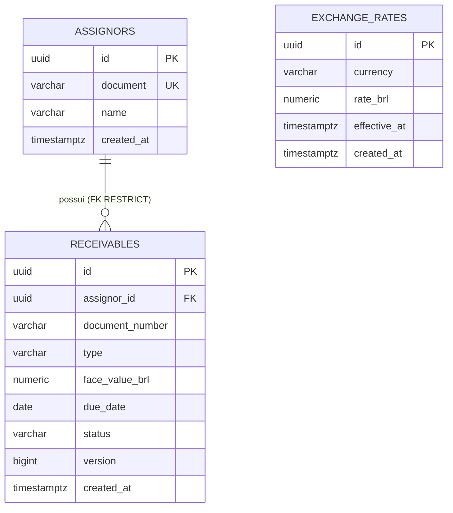

# TASK-005 — Plano Técnico de Implementação

## 1. Identificação
- **Tarefa:** `TASK-005` — Banco PostgreSQL, migrations e entidades iniciais.
- **Objetivo:** estabelecer camada de persistência reproduzível, com Flyway como única origem do schema, Hibernate em `ddl-auto=validate`, integridade garantida por constraints do PostgreSQL e mapeamentos JPA coerentes com `docs/contracts.md` e o OpenAPI oficial, sem antecipar liquidação/idempotência (TASK-009/010).
- **Status do planejamento:** `CONCLUÍDO (DONE)` — Código e testes aprovados em Code Review pelo responsável em 2026-11-06.
- **Referências:** `SPEC.md` (§§1–3, 5); `DECISIONS.md` (`DEC-001`, `DEC-002`, `DEC-003`, `DEC-006`, `DEC-007`, `DEC-008`, `DEC-010`); `docs/contracts.md` (§§1–3); `docs/openapi/srm-credit-engine.yaml` (schemas `AssignorResponse`, `CreateReceivableRequest`, `ReceivableResponse`, `CreateExchangeRateRequest`, `ExchangeRateResponse`); `AGENTS.md` (`G-01` a `G-04`); `TASKS.md` (`TASK-005`, R-04, R-22).
- **Dependências:** `TASK-002` (status atual `VALIDATION` — ver D-01).
- **Ferramenta e modelo de IA elaborador:** Google Antigravity — Claude Opus 5.5 (Medium).

## 2. Diagnóstico do Estado Atual

| Item | Evidência | Situação |
|---|---|---|
| Stack | `pom.xml`: Spring Boot `4.1.2`, Java 21, `spring-boot-starter-data-jpa`, `spring-boot-starter-flyway`, `flyway-database-postgresql`, `postgresql` (runtime), starters `*-test` | Completa — **nenhuma dependência nova** |
| Testcontainers | `testcontainers-postgresql` / `testcontainers-junit-jupiter` 2.0.5; `TestcontainersConfiguration` com `@ServiceConnection` (`postgres:16-alpine`) | Reutilizável |
| Configuração | `application.yaml`: `ddl-auto: validate`, `open-in-view: false`, `hibernate.jdbc.time_zone: UTC`, Flyway `classpath:db/migration` | **Sem alteração necessária** |
| Migrations | TASK-001 criou apenas `db/migration/.gitkeep`; TASK-003/004 não criaram SQL | A confirmar no ST-01 (listagem não executada no planejamento) |
| Entidades JPA | Inexistentes | Faltam |
| Enums reutilizáveis | `pricing.domain.model.ReceivableType` (`DUPLICATA_MERCANTIL`, `CHEQUE_PRE_DATADO`), `pricing.domain.model.CurrencyCode` (`BRL`, `USD`) | Reutilizar sem modificar |
| Modelo contratado | `docs/contracts.md` §2: `assignors`, `receivables`, `exchange_rates` | Base do modelo |
| Diagrama ER | Exigido pela TASK-005 / R-22 | Falta |

## 3. Abordagem Técnica Proposta

### 3.1. Organização de pacotes (Package by Feature)
Regra: **tudo que importa `jakarta.persistence` fica em `<feature>.persistence`**; `domain` permanece Java puro (padrão de `pricing.domain`).

```text
com.claudiocarige.backendcreditengine
├── pricing.domain.*            (INTOCADO — sem JPA)
├── assignor.persistence        Assignor (somente leitura, @Immutable)
├── receivable.domain           ReceivableStatus (enum Java puro)
├── receivable.persistence      Receivable
└── exchangerate.persistence    ExchangeRate (append-only, @Immutable)
```

- Dependência apenas `persistence → domain` (`Receivable` usa `ReceivableType`; `ExchangeRate` usa `CurrencyCode`).
- **Sem repositórios Spring Data, services, DTOs ou controllers nesta tarefa** (nascem com suas consultas nas TASK-006/008). Testes usam `TestEntityManager` + `JdbcTemplate`.

### 3.2. Modelo relacional
Convenções: constraints nomeadas (`pk_`, `fk_`, `uk_`, `ck_`) para tradução futura de `409` por nome de constraint; nenhum `ON DELETE CASCADE`; sem `DEFAULT` concorrente ao `Clock` da aplicação.

**`assignors`** (seed + leitura)

| Coluna | Tipo | Null | Regra |
|---|---|---|---|
| `id` | `UUID` | NOT NULL | `pk_assignors` |
| `document` | `VARCHAR(14)` | NOT NULL | `uk_assignors_document`; `ck_assignors_document_digits`: `document ~ '^[0-9]{11,14}$'` |
| `name` | `VARCHAR(150)` | NOT NULL | `ck_assignors_name_not_blank`: `length(btrim(name)) > 0` |
| `created_at` | `TIMESTAMPTZ` | NOT NULL | — |

**`receivables`**

| Coluna | Tipo | Null | Regra |
|---|---|---|---|
| `id` | `UUID` | NOT NULL | `pk_receivables` |
| `assignor_id` | `UUID` | NOT NULL | `fk_receivables_assignor` → `assignors(id)` `ON DELETE RESTRICT` |
| `document_number` | `VARCHAR(64)` | NOT NULL | `ck_receivables_document_number_format`: `~ '^[A-Z0-9._/-]{1,64}$'` (rejeita valor não normalizado) |
| `type` | `VARCHAR(32)` | NOT NULL | `ck_receivables_type`: `IN ('DUPLICATA_MERCANTIL','CHEQUE_PRE_DATADO')` |
| `face_value_brl` | `NUMERIC(19,2)` | NOT NULL | `ck_receivables_face_value_brl_range`: `BETWEEN 0.01 AND 999999999.99` |
| `due_date` | `DATE` | NOT NULL | Sem CHECK temporal (regra da aplicação) |
| `status` | `VARCHAR(16)` | NOT NULL | `ck_receivables_status`: `IN ('OPEN','SETTLED')`, sem default |
| `version` | `BIGINT` | NOT NULL | `@Version` |
| `created_at` | `TIMESTAMPTZ` | NOT NULL | — |

- `uk_receivables_assignor_document_number (assignor_id, document_number)` — seu índice (prefixo `assignor_id`) atende FK e filtro `assignorId`.
- Nenhum índice adicional agora; `(assignor_id, status, due_date)` só na TASK-008 se a consulta real justificar (DEC-008).

**`exchange_rates`** (append-only — condicionado a D-03)

| Coluna | Tipo | Null | Regra |
|---|---|---|---|
| `id` | `UUID` | NOT NULL | `pk_exchange_rates` |
| `currency` | `VARCHAR(3)` | NOT NULL | `ck_exchange_rates_currency`: `currency = 'USD'` |
| `rate_brl` | `NUMERIC(19,6)` | NOT NULL | `ck_exchange_rates_rate_brl_range`: `BETWEEN 0.000001 AND 9999999.999999` |
| `effective_at` | `TIMESTAMPTZ` | NOT NULL | — |
| `created_at` | `TIMESTAMPTZ` | NOT NULL | — |

- `uk_exchange_rates_currency_effective_at (currency, effective_at)` — o índice atende a seleção de vigência da TASK-006 (`currency = ? AND effective_at <= ? ORDER BY effective_at DESC LIMIT 1`). Nenhum índice extra.

**Banco × aplicação**

| Regra | Banco | Aplicação |
|---|---|---|
| Faixas monetárias e cambiais, enums, formato normalizado, unicidade e integridade referencial | `CHECK`, `UNIQUE` e `FOREIGN KEY` | Validação adicional nas camadas apropriadas (TASK-006/008) |
| `dueDate > operationDate` | Não depende exclusivamente do banco, pois utiliza a data de referência da operação | TASK-008 (`422 INVALID_DUE_DATE`) |
| Precisão decimal de valores monetários (`scale <= 2`) | `NUMERIC(19,2)` define a escala armazenada, mas pode arredondar entradas com precisão excedente antes da aplicação dos `CHECK` | Validar explicitamente `BigDecimal.scale()` antes da persistência e rejeitar escala superior a 2 |
| Precisão decimal das cotações (`scale <= 6`) | `NUMERIC(19,6)` define a escala armazenada, mas não garante rejeição de entradas com mais de seis casas decimais | Validar explicitamente `BigDecimal.scale()` antes da persistência e rejeitar escala superior a 6 |
| Transição `OPEN → SETTLED` irreversível | Não implementada nesta tarefa | TASK-009 |
| Vigência cambial e ausência de cotação | Não aplicável como validação estática do schema | TASK-006 |

**Política de precisão decimal**

As entidades persistentes devem validar explicitamente a escala dos valores financeiros recebidos antes de qualquer operação de persistência.

A validação deve utilizar `BigDecimal.scale()` para identificar entradas cuja quantidade de casas decimais exceda o limite definido pelo contrato.

Não utilizar exclusivamente `setScale(n, RoundingMode.UNNECESSARY)` como mecanismo de rejeição de escala excedente, pois esse método permite remover zeros decimais sem perda de valor.

Entradas com escala superior ao limite contratual devem ser rejeitadas, mesmo quando possuírem zeros adicionais, respeitando a política de validação estrita adotada no projeto.

As constraints `CHECK` do PostgreSQL continuam responsáveis pelas faixas numéricas, enquanto a validação de escala pertence à aplicação.

**Limitação conhecida:** operações SQL diretas que não passem pelas validações da aplicação podem sofrer arredondamento pelo PostgreSQL. As validações das entidades não substituem controles sobre outros caminhos de escrita no banco.

`NUMERIC(10,6)` (taxa base/spread) não é utilizado nesta tarefa — pertence aos snapshots da TASK-009.

### 3.3. Estratégia Flyway

| Migration | Conteúdo |
|---|---|
| `V1__create_assignors_and_receivables.sql` | `assignors` e `receivables` |
| `V2__create_exchange_rates.sql` | `exchange_rates` (D-03) |

- Versões inteiras sequenciais; futuras `V3+` (liquidação na TASK-009).
- Sem `IF NOT EXISTS`, sem `CREATE EXTENSION` (UUID gerado pela aplicação), sem seeds.
- DDL transacional do PostgreSQL: falha não deixa schema parcial.
- **Migrations aplicadas nunca são editadas**; correções sempre em nova `Vn`.
- Mesmo conjunto em desenvolvimento e teste; `clean` permanece desabilitado; sem `baseline-on-migrate`.
- `ddl-auto=validate` **não verifica precisão, escala, nulabilidade nem constraints** → coberto por teste de metadados.
- `.gitkeep` preservado (remoção exigiria autorização de exclusão).

### 3.4. Mapeamento JPA

| Aspecto | Decisão |
|---|---|
| Identificadores | Utilizar `@Id` e `@GeneratedValue(strategy = GenerationType.UUID)`, com identificadores Java `UUID` e colunas PostgreSQL `UUID`. |
| Valores monetários | Utilizar `BigDecimal` com `@Column(precision = 19, scale = 2)`. Validar explicitamente `scale() <= 2`, nulidade e limites contratuais antes da persistência, sem arredondamento silencioso. |
| Cotações cambiais | Utilizar `BigDecimal` com `@Column(precision = 19, scale = 6)`. Validar explicitamente `scale() <= 6` e o intervalo `[0.000001, 9999999.999999]`, sem arredondamento silencioso. |
| Datas e timestamps | Utilizar `LocalDate` para `DATE` e `Instant` para `TIMESTAMPTZ`. Timestamps gerados pelo backend poderão ser normalizados para microssegundos. O tratamento de precisão excedente em `effectiveAt` recebido externamente depende da decisão D-04 e da compatibilidade com o OpenAPI. |
| Enums | Utilizar `@Enumerated(EnumType.STRING)`, reaproveitando `ReceivableType` e `CurrencyCode`. A entidade `ExchangeRate` deve aceitar exclusivamente `USD`, conforme o modelo contratado. |
| Relacionamento Receivable → Assignor | Utilizar `@ManyToOne(fetch = FetchType.LAZY, optional = false)` e `@JoinColumn(nullable = false, updatable = false)`. Não implementar relacionamento `@OneToMany` inverso, cascade ou orphan removal nesta tarefa. |
| Imutabilidade dos dados | Utilizar `updatable = false` para atributos que não devem ser modificados após a criação. Aplicar `@org.hibernate.annotations.Immutable` em `Assignor` e `ExchangeRate`. |
| Limitações de @Immutable | A anotação restringe atualizações pelo gerenciamento de entidades do Hibernate, mas não impede modificações por SQL direto. Não criar triggers ou controles adicionais de banco sem requisito e autorização específicos. |
| Concorrência | Utilizar `@Version Long version` na entidade `Receivable` como mecanismo complementar de controle otimista. A estratégia definitiva de concorrência, locks e idempotência pertence às TASK-009/010. |
| Encapsulamento | Utilizar construtor `protected` sem argumentos para compatibilidade com JPA. Disponibilizar construtores com validações para `Receivable` e `ExchangeRate`, sem setters públicos indiscriminados. A entidade `Assignor` será carregada inicialmente por dados externos à API, conforme estratégia de seed futura. |
| Normalização | Normalizar `documentNumber` utilizando `trim().toUpperCase(Locale.ROOT)` no construtor de `Receivable`, conforme `docs/contracts.md`. Preservar o CHECK do PostgreSQL como proteção adicional. |
| Estado inicial | Inicializar `Receivable.status` como `OPEN`. Não criar método `settle()` ou implementar transições financeiras nesta tarefa. |
| equals/hashCode | Não sobrescrever inicialmente. Reavaliar somente se surgir uma necessidade concreta de igualdade entre entidades, considerando o ciclo de vida dos identificadores JPA. |
| Consultas e N+1 | Manter o relacionamento com `FetchType.LAZY`. Na TASK-008, utilizar projeções ou fetch joins quando a consulta exigir dados do cedente, evitando carregamento individual de relacionamentos. |
| Núcleo financeiro | Preservar integralmente `pricing.*`, sem introduzir JPA, Spring ou lógica de persistência nas classes financeiras das TASK-003/004. |

**Diretrizes complementares**

1. As validações realizadas nos construtores não substituem as constraints do PostgreSQL nem as validações das camadas de entrada.

2. A validação de escala deve rejeitar explicitamente valores cuja escala original exceda o limite contratual, inclusive quando as casas excedentes forem zeros.

3. Os valores de `createdAt` gerados pela aplicação devem utilizar uma fonte de tempo controlada pelo backend. A precisão temporal efetiva deve ser compatível com o PostgreSQL e comprovada por testes.

4. A política para `effectiveAt` com precisão superior a microssegundos será definida na D-04 antes de implementar sua validação ou normalização.

5. O atributo `version` deve permanecer sob gerenciamento do Hibernate. Atualizações futuras por SQL nativo deverão considerar explicitamente o controle de concorrência.

6. A anotação `@Immutable` não constitui, isoladamente, garantia de imutabilidade física dos registros no PostgreSQL.

7. Não introduzir repositórios, serviços, controllers, DTOs, mappers ou regras de liquidação na TASK-005.

### 3.5. Diagrama ER (a ser mantido em `docs/er-diagram.md`)



## 4. Justificativa e Alternativas

- **Organização por feature:** as entidades JPA permanecem em `<feature>.persistence`, preservando `domain` para modelos e regras de negócio independentes de persistência. Não criar modelos paralelos e mappers sem necessidade concreta.
- **Flyway como fonte do schema:** utilizar migrations versionadas para criação e evolução das tabelas. O Hibernate deve apenas validar o mapeamento com `ddl-auto=validate`.
- **Integridade relacional:** definir constraints `PK`, `FK`, `UNIQUE` e `CHECK` nomeadas, garantindo regras estruturais diretamente no PostgreSQL.
- **Precisão financeira:** validar explicitamente `BigDecimal.scale()` e os limites contratuais antes da persistência, rejeitando valores com precisão excedente. As constraints do banco permanecem como proteção complementar para faixas numéricas e integridade.
- **Limitação do PostgreSQL:** colunas `NUMERIC(p,s)` podem arredondar valores recebidos com escala superior à declarada. As validações das entidades protegem os caminhos de escrita que passam por elas, mas não impedem arredondamentos em operações SQL diretas.
- **Sem repositórios nesta tarefa:** os repositórios Spring Data serão introduzidos nas TASK-006/008, quando as necessidades reais de consulta estiverem definidas. Os testes da TASK-005 utilizarão ferramentas de persistência e SQL para verificar mapeamentos e constraints.
- **Controle otimista complementar:** manter `@Version` na entidade `Receivable` para detecção de alterações concorrentes via Hibernate, sem antecipar a estratégia definitiva de liquidação das TASK-009/010.
- **Imutabilidade:** utilizar `@Immutable` em `Assignor` e `ExchangeRate`, reconhecendo que essa anotação não impede alterações por SQL direto.
- **Índices por necessidade:** aproveitar os índices criados pelas constraints `UNIQUE`, adicionando outros somente quando as consultas reais justificarem sua criação.
- **Estratégia de migrations:** criar `V1__create_assignors_and_receivables.sql` e `V2__create_exchange_rates.sql` na TASK-005. A inclusão de `exchange_rates` foi aprovada na revisão da D-03, pois seu modelo já está contratado e será utilizado pela TASK-006.
- **Dados iniciais:** não incluir seeds nas migrations estruturais desta tarefa. As cargas necessárias serão definidas nas TASK-006/008, separando dados de desenvolvimento de dados exigidos pelos ambientes de execução.
- **Precisão temporal:** manter `Instant` para timestamps e `TIMESTAMPTZ` no PostgreSQL. A política para valores com precisão superior a microssegundos deverá ser definida na D-04 antes da implementação correspondente.
- **Evolução incremental:** não antecipar as tabelas `settlements`, `settlement_items` ou os mecanismos de idempotência das TASK-009/010.

**Alternativas não adotadas:** geração automática de schema pelo Hibernate, H2 como substituto dos testes PostgreSQL, criação antecipada de repositórios e serviços, duplicação de modelos persistentes sem necessidade, inclusão prematura de tabelas de liquidação e migrations de dados exclusivamente de desenvolvimento executadas em todos os ambientes.

## 5. Arquivos Previstos
Base: `d:\PARTICULAR\CARREIRA PROFISSIONAL\SRMASSET\srm-credit-engine\`. `{pkg}` = `backendcreditengine\src\main\java\com\claudiocarige\backendcreditengine`; `{tpkg}` = equivalente em `src\test\java`.

| Ação | Arquivo | Finalidade |
|---|---|---|
| Criar | `backendcreditengine\src\main\resources\db\migration\V1__create_assignors_and_receivables.sql` | Criar as tabelas assignors e receivables, incluindo constraints e relacionamentos. |
| Criar | `backendcreditengine\src\main\resources\db\migration\V2__create_exchange_rates.sql` | Criar a tabela exchange_rates, incluindo constraints de cotação e unicidade temporal. |
| Criar | `{pkg}\assignor\persistence\Assignor.java` | Entidade JPA de cedentes, utilizada inicialmente para leitura |
| Criar | `{pkg}\receivable\domain\ReceivableStatus.java` | Enum de domínio com os estados `OPEN` e `SETTLED`. |
| Criar | `{pkg}\receivable\persistence\Receivable.java` | EEntidade JPA com validações financeiras, relacionamento com cedente e controle  `@Version`. |
| Criar | `{pkg}\exchangerate\persistence\ExchangeRate.java` | Entidade JPA para histórico cambial append-only. |
| Criar | `{tpkg}\DatabaseSchemaTest.java` | Validar Flyway e metadados (tipo/precisão/escala/nulabilidade) do schema PostgreSQL. |
| Criar | `{tpkg}\assignor\persistence\AssignorPersistenceTest.java` | Validar constraints e persistência de cedentes. |
| Criar | `{tpkg}\receivable\persistence\ReceivablePersistenceTest.java` | Validar relacionamentos, constraints, persistência e carregamento LAZY. |
| Criar | `{tpkg}\receivable\persistence\ReceivableTest.java` | Validar regras de construção, normalização, estado inicial e precisão financeira. |
| Criar | `{tpkg}\exchangerate\persistence\ExchangeRatePersistenceTest.java` | Validar persistência, unicidade, limites cambiais e timestamps. |
| Criar | `{tpkg}\exchangerate\persistence\ExchangeRateTest.java` | Validar regras de construção, limites de cotação e precisão temporal definida na D-04. |
| Criar | `docs\er-diagram.md` | Documentar o modelo entidade-relacionamento em Mermaid, conforme R-22. |
| Alterar | `docs\task-plans\TASK-005.md` | Atualizar o planejamento aprovado, registrar execução, resultados reais dos testes e evidências. |
| Alterar | `TASKS.md` | egistrar o início e o andamento da TASK-005, atualizar a rastreabilidade e alterar seu status conforme as evidências de execução |
| Alterar (condicional) | `DECISIONS.md` | Seção DEC-008, se houver alteração verificar G-04, somente se D-02 aprovada |
| Sem mudança | `pom.xml`, `application.yaml`, `TestcontainersConfiguration.java`, `BackendcreditengineApplicationTests.java`, `pricing.*` | — |

### 5.2. Arquivos expressamente preservados

- `DECISIONS.md`
- `pom.xml`
- `backendcreditengine/src/main/resources/application.yaml`
- `TestcontainersConfiguration.java`
- `BackendcreditengineApplicationTests.java`
- Todas as classes existentes em `pricing.*`

A verificação dos estados das decisões arquiteturais não autoriza modificações automáticas em `DECISIONS.md`.

Caso seja identificada uma inconsistência que exija alteração de decisão aprovada ou aprovação de decisão pendente, deverá ser apresentada uma solicitação específica conforme G-04.

Qualquer necessidade de criar ou modificar arquivos adicionais deverá ser justificada e submetida à autorização G-01 antes da execução.

### 5.3. Limites de implementação

A TASK-005 está limitada ao modelo persistente inicial, às migrations, aos testes de integração e à documentação do modelo relacional.

Não implementar nesta tarefa:

- Repositórios Spring Data e consultas de negócio das TASK-006/008.
- Controllers, services ou DTOs HTTP.
- Lógica de cálculo financeiro nas entidades JPA.
- Tabelas de liquidação ou snapshots financeiros.
- Protocolo de idempotência e controle de locks das TASK-009/010.
- Seeds específicas de desenvolvimento.

A implementação permanece condicionada à resolução das decisões e dependências indicadas na seção 10 e à autorização G-01.

## 6. Subtarefas de Implementação

| Ordem | Subtarefa | Resultado esperado |
|---|---|---|
| ST-01 | Inspeção read-only (`db/migration`, `src/main/java`, `git status --short`) | Ausência de migrations/entidades confirmada; se houver migration existente, interromper e replanejar |
| ST-02 | Registrar `IN_PROGRESS` no `TASKS.md` | Status rastreável |
| ST-03 | Criar `V1__create_assignors_and_receivables.sql` | Schema V1 |
| ST-04 | Criar `V2__create_exchange_rates.sql` (se D-03 = A) | Schema V2 |
| ST-05 | Criar `ReceivableStatus`, `Assignor`, `Receivable`, `ExchangeRate` | `contextLoads` existente aprovado (prova `ddl-auto=validate`) |
| ST-06 | Testes unitários das guardas | Verdes sem Docker |
| ST-07 | Testes de integração PostgreSQL/Testcontainers | Constraints comprovadas por SQLState e nome |
| ST-08 | Criar `docs/er-diagram.md` | ER coerente com V1/V2 |
| ST-09 | `clean test` completo + `git diff --check` | `BUILD SUCCESS`, sem regressões |
| ST-10 | Atualizar este plano, `TASKS.md` → `VALIDATION`, DEC-008 (se D-02) | Evidências registradas |
| ST-11 | Code review (AGENTS §12), somente análise | Relatório com classificação |

## 7. Critérios de Aceite
- **CA-01:** Migrations V1/V2 aplicadas com sucesso em PostgreSQL 16 via Testcontainers.
- **CA-02:** Contexto inicia com `ddl-auto=validate`, sem geração automática de schema.
- **CA-03:** Tipos, precisão (`NUMERIC(19,2)`, `NUMERIC(19,6)`), `DATE`, `TIMESTAMPTZ`, `UUID` e `NOT NULL` comprovados por metadados.
- **CA-04:** Todas as PK/FK/UNIQUE/CHECK da seção 3.2 comprovadas por rejeição real do PostgreSQL, com SQLState e nome de constraint.
- **CA-05:** Nenhum arredondamento silencioso possível pela aplicação (escala excedente rejeitada).
- **CA-06:** Sem cascade destrutivo; exclusão de cedente com recebíveis rejeitada.
- **CA-07:** Relacionamento `LAZY` comprovado; sem coleções que gerem N+1.
- **CA-08:** Nenhuma alteração em `pricing.*`; nenhuma dependência JPA no núcleo financeiro.
- **CA-09:** Diagrama ER disponível e coerente com as migrations.
- **CA-10:** Suíte completa sem regressões (57 testes existentes + novos).

## 8. Estratégia de Testes
- **Configuração:** `@DataJpaTest` + `@AutoConfigureTestDatabase(replace = NONE)` + `@Import(TestcontainersConfiguration.class)`. Verificar os pacotes dessas anotações no Spring Boot 4 e a execução do Flyway no slice; fallback: `@SpringBootTest` + mesmo `@Import`. Sem H2, sem mocks de constraints.
- **Técnica:** round-trip `persist → flush → clear → find`; violações via SQL nativo (`JdbcTemplate`) para contornar as guardas das entidades; uma violação por método (transação PG abortada após erro); asserção extrai `PSQLException` da cadeia e verifica `SQLState` (`23505`, `23503`, `23502`, `23514`, `22003`) e `getServerErrorMessage().getConstraint()`.

| Teste | Cenários |
|---|---|
| `DatabaseSchemaTest` | V1/V2 `success` em `flyway_schema_history`; `information_schema.columns` (tipos, precisão, escala, `is_nullable`) |
| `AssignorPersistenceTest` | Documento duplicado; 10/15 dígitos ou letras; nome em branco; `name` nulo; leitura mapeada de linha inserida via SQL |
| `ReceivablePersistenceTest` | Round-trip (escala 2, `LocalDate`, `Instant` UTC, enums string, `OPEN`, `version = 0`); duplicidade no mesmo cedente (`23505`) e permissão entre cedentes distintos; FK inexistente e exclusão de cedente referenciado (`23503`); `0.00`/`1000000000.00` rejeitados e bordas `0.01`/`999999999.99` aceitas; overflow (`22003`); `type`/`status` inválidos; `document_number` minúsculo/com espaços; NOT NULL; `Hibernate.isInitialized(assignor) == false` |
| `ExchangeRatePersistenceTest` | Round-trip escala 6 (`5.432100`); `(USD, effective_at)` duplicado; `BRL`; `0.000000` e `10000000.000000` rejeitados; bordas aceitas |
| `ReceivableTest` / `ExchangeRateTest` | Normalização (`" dup-1 "` → `"DUP-1"`); escala 3/7 rejeitada; nulos; `BRL` rejeitado; truncamento para micros; estado inicial `OPEN` |

**Comandos previstos** (diretório `backendcreditengine\`, `JAVA_HOME=C:\Program Files\Zulu\zulu-21`, Docker ativo):

| Comando | Finalidade |
|---|---|
| `Get-ChildItem -Recurse -Name src\main\resources\db, src\main\java`; `git status --short` | ST-01 |
| `.\mvnw.cmd -B test "-Dtest=BackendcreditengineApplicationTests"` | ST-05 |
| `.\mvnw.cmd -B test "-Dtest=*PersistenceTest,DatabaseSchemaTest,ReceivableTest,ExchangeRateTest"` | ST-06/07 |
| `.\mvnw.cmd -B clean test`; `git diff --check` | ST-09 |

Branch, commit e push exigem autorização específica (G-03).

## 9. Riscos e Mitigações

| Risco | Impacto | Mitigação |
|---|---|---|
| Arredondamento silencioso do `NUMERIC` | Divergência financeira ao centavo | Guarda `setScale(n, UNNECESSARY)` + testes |
| `validate` não cobre precisão/constraints | Schema divergente não detectado | `DatabaseSchemaTest` com metadados |
| Pacotes do slice de teste no Boot 4 | Falha de compilação/contexto | Verificar classpath; fallback `@SpringBootTest` |
| Precisão de `Instant` (100 ns) × microssegundos do PG | Round-trip inconsistente; unicidade de `effective_at` não determinística | Truncamento para `MICROS` (D-04) |
| Migration existente não detectada | Conflito de versão | ST-01 interrompe e replaneja |
| Versão do PostgreSQL divergente no Compose (TASK-016) | Comportamento distinto | Usar a mesma major (16) |
| `LazyInitializationException` na TASK-008 | Erro em runtime | Fetch join/projeção na TASK-008 |

## 10. Decisões Pendentes e Divergências Documentais

| ID | Tema | Decisão / Encaminhamento | Status |
|---|---|---|---|
| D-01 | Dependência da TASK-002 | Confirmar a aprovação formal da TASK-002 no `TASKS.md` vigente. Caso permaneça em `VALIDATION`, o início da TASK-005 dependerá de autorização humana explícita para essa exceção. | `PAPPROVED` |
| D-02 | Política de persistência — DEC-008 | Preservar Flyway como única fonte de evolução do schema, constraints nomeadas e índices baseados nas consultas reais. A DEC-008 consta como `APPROVED` no documento de referência disponibilizado; confirmar a mesma condição no workspace antes da implementação. | `RESOLVIDA NA REFERÊNCIA — VERIFICAR WORKSPACE` |
| D-03 | Criação da tabela `exchange_rates` | Incluir a tabela na TASK-005 por meio da migration `V2__create_exchange_rates.sql`, preservando a implementação do Currency Engine para a TASK-006. | `APROVADA NA REVISÃO` |
| D-04 | Precisão temporal PostgreSQL/JPA | Definir explicitamente o tratamento de `Instant` com precisão superior a microssegundos, distinguindo timestamps gerados pelo backend de valores `effective_at` recebidos externamente. A política deverá preservar a semântica de vigência e respeitar o contrato OpenAPI. | `APPROVED` |
| D-05 | Estratégia de dados iniciais (seeds) | Não incluir seeds nas migrations estruturais da TASK-005. Planejar a carga de dados necessários nas TASK-006/008, mantendo dados exclusivamente de desenvolvimento separados das migrations estruturais aplicadas em todos os ambientes. | `PROPOSTA MANTIDA — RATIFICAR NA APROVAÇÃO` |

**Idempotência — DEC-007 × TASK-010:** política vigente consistente — registro definitivo da chave na **mesma transação** dos efeitos financeiros; reserva `IN_PROGRESS` em transação independente aparece apenas como alternativa rejeitada. Pontos a verificar antes da migration `V3` (TASK-009/010), sem impacto na TASK-005:
1. Localização da chave: `settlements` (`contracts.md` §2.4) ou tabela própria ("modelo definido para a operação", TASK-009).
2. Ordem de inserção: "registro atômico da chave antes dos efeitos financeiros" com totais `NOT NULL` no cabeçalho exige cálculo em memória e inserção do cabeçalho antes de itens e `UPDATE` de status.
3. Papel do lock pessimista (`FOR UPDATE` + `SET LOCAL lock_timeout`, semântica `503`) frente ao `version` otimista.

**Divergências fora do escopo (tarefa documental separada recomendada):** DEC-005 `PROPOSED` na tabela × `APPROVED` na seção do `DECISIONS.md`; `TASKS.md` §8 sem linha da TASK-004 e "Próxima ação" desatualizada.

## 11. Preparação para Tarefas Futuras

| Tarefa | Entregue pela TASK-005 | Fica para depois |
|---|---|---|
| TASK-006 | Tabela, UNIQUE/índice de vigência, `ExchangeRate` imutável, constraint nomeada para `409` | Repositório `<= instante`, endpoints, seed dev, política de input sub-µs |
| TASK-008 | Tabelas, FK, UNIQUE normalizada, `OPEN`, constraint nomeada para `DUPLICATE_RECEIVABLE_DOCUMENT` | Repositórios, consultas de listagem, possível índice de status, `422` de vencimento, seed de cedentes |
| TASK-009 (V3+) | PK UUID de `receivables` para `settlement_items.receivable_id` (FK + UNIQUE), `version`, colunas imutáveis | `settlements`, `settlement_items`, snapshots, imutabilidade, `settle()` |
| TASK-010 | Nenhuma estrutura antecipada | Pontos de verificação da seção 10 |

## 12. Revisão e Aprovação Humana
- **Plano apresentado:** 2026-11-05
- **Ajustes solicitados:** nenhum até o momento
- **Situação:** CONCLUÍDA E APROVADA EM CODE REVIEW (2026-11-06)
- **Aprovação:** Aprovada integralmente pelo responsável em 2026-11-06.

## 13. Histórico de Revisões

| Revisão | Alteração | Justificativa | Aprovação |
|---|---|---|---|
| 1.0 | Elaboração inicial do plano técnico da `TASK-005` | Definir modelo relacional, Flyway, JPA e testes de integridade | Aprovado (2026-11-06) |
| 1.1 | Implementação concluída das migrations, entidades, testes e diagrama ER | Execução autorizada e suíte de testes 100% verde | Aprovado (2026-11-06) |
| 1.2 | Aprovação formal do Code Review pelo responsável e encerramento | Cumprimento integral do DoD e critérios de aceite | Aprovado (2026-11-06) |

## 14. Resultado da Execução
- **Status:** `DONE` (implementação concluída e aprovada em Code Review pelo responsável em 2026-11-06; 90 testes passando sem regressões).
- **Arquivos realmente criados/alterados:**
  - `backendcreditengine\src\main\resources\db\migration\V1__create_assignors_and_receivables.sql` (schema V1)
  - `backendcreditengine\src\main\resources\db\migration\V2__create_exchange_rates.sql` (schema V2)
  - `backendcreditengine\src\main\java\com\claudiocarige\backendcreditengine\assignor\persistence\Assignor.java` (entidade JPA de cedente @Immutable)
  - `backendcreditengine\src\main\java\com\claudiocarige\backendcreditengine\receivable\domain\ReceivableStatus.java` (enum OPEN / SETTLED)
  - `backendcreditengine\src\main\java\com\claudiocarige\backendcreditengine\receivable\persistence\Receivable.java` (entidade JPA de recebível com normalização, guarda de escala e @Version)
  - `backendcreditengine\src\main\java\com\claudiocarige\backendcreditengine\exchangerate\persistence\ExchangeRate.java` (entidade JPA de cotação @Immutable com normalização de escala e timestamps)
  - `backendcreditengine\src\test\java\com\claudiocarige\backendcreditengine\receivable\persistence\ReceivableTest.java` (6 testes unitários de invariantes e normalização)
  - `backendcreditengine\src\test\java\com\claudiocarige\backendcreditengine\exchangerate\persistence\ExchangeRateTest.java` (6 testes unitários de limites cambiais e timestamps)
  - `backendcreditengine\src\test\java\com\claudiocarige\backendcreditengine\DatabaseSchemaTest.java` (2 testes de metadados e histórico Flyway)
  - `backendcreditengine\src\test\java\com\claudiocarige\backendcreditengine\assignor\persistence\AssignorPersistenceTest.java` (6 testes de persistência e constraints de cedente)
  - `backendcreditengine\src\test\java\com\claudiocarige\backendcreditengine\receivable\persistence\ReceivablePersistenceTest.java` (9 testes de persistência, constraints e LAZY loading)
  - `backendcreditengine\src\test\java\com\claudiocarige\backendcreditengine\exchangerate\persistence\ExchangeRatePersistenceTest.java` (4 testes de persistência e unicidade de câmbio)
  - `docs\er-diagram.md` (diagrama ER em Mermaid e documentação de constraints)
  - `TASKS.md` (atualização de status e rastreabilidade)
  - `docs\task-plans\TASK-005.md` (registro de evidências e resultados)
- **Comandos executados:**
  - `.\mvnw.cmd -B test -Dtest=BackendcreditengineApplicationTests`
  - `.\mvnw.cmd -B test -Dtest=ReceivableTest,ExchangeRateTest`
  - `.\mvnw.cmd -B test -Dtest=DatabaseSchemaTest,AssignorPersistenceTest,ReceivablePersistenceTest,ExchangeRatePersistenceTest`
  - `.\mvnw.cmd -B clean test`
  - `git diff --check`
- **Testes e resultados:** 90 testes executados, 0 falhas, 0 erros (`BUILD SUCCESS`), sendo 33 novos testes adicionados pela TASK-005 (12 unitários + 21 de integração/PostgreSQL via Testcontainers) e 57 testes prévios preservados.
- **Desvios do planejamento:** Nenhum desvio funcional. Ajuste técnico nas asserções de teste para separar erro `22001` (truncamento de `VARCHAR(14)`) de erro `23514` (regex da constraint de dígitos).
- **Riscos remanescentes:** Nenhum risco bloqueante. Mapeamento e constraints 100% validados contra PostgreSQL 16 real.

